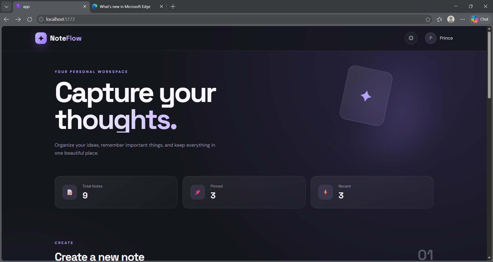
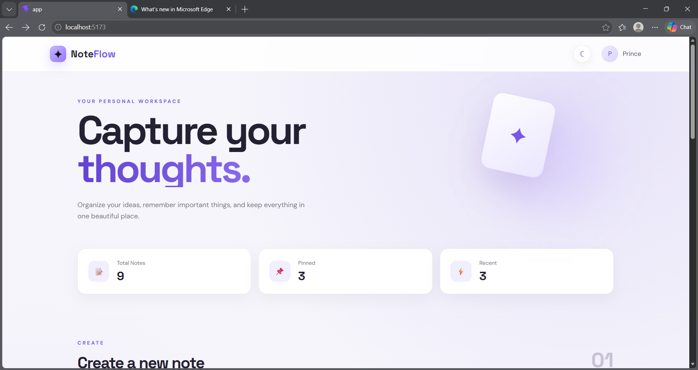
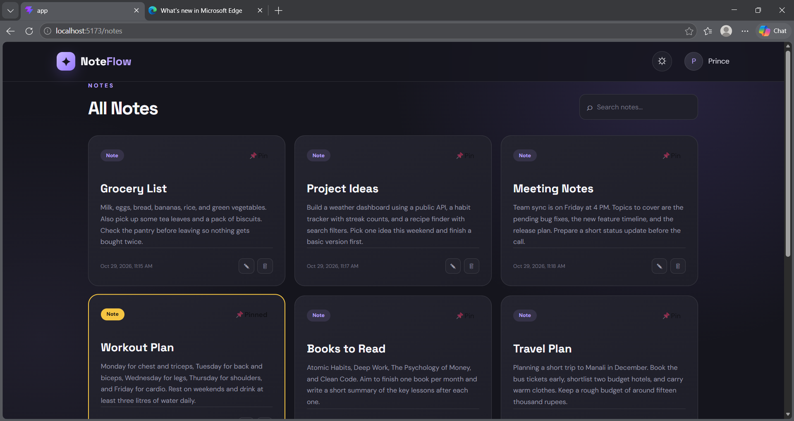
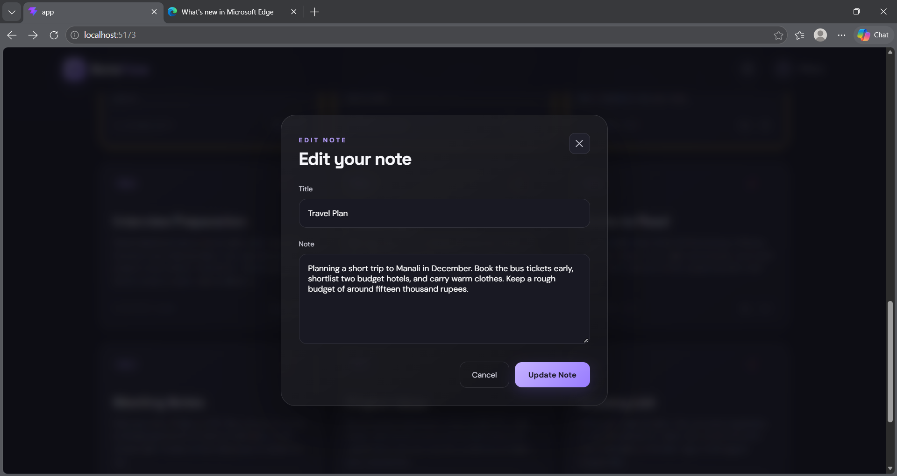

<div align="center">

# 📝 NoteFlow

### A clean, fast and beautiful notes app to capture your ideas


[Features](#-features) • [Screenshots](#-screenshots) • [Tech Stack](#-tech-stack) • [Getting Started](#-getting-started) • [Project Structure](#-project-structure)

</div>

---

## 🌐 Live Demo

Try NoteFlow right now in your browser: **[noteflow-one.vercel.app](https://noteflow-one.vercel.app/)**

## 📖 About

**NoteFlow** is a modern notes app built with React and Vite. Write down your thoughts, pin the important ones, search through everything in seconds, and switch between light and dark themes. There is no sign-up and no backend: your notes are saved right in your browser, so they are always there when you come back.

## ✨ Features

| Feature | Description |
| --- | --- |
| ➕ **Create notes** | Add a note with a title and detail in seconds |
| ✏️ **Edit in a modal** | Update any note without leaving the page |
| 🗑️ **Delete notes** | Remove the notes you no longer need |
| 📌 **Pin important notes** | Pinned notes always stay at the top |
| 🔍 **Instant search** | Search by title or detail as you type |
| 🎯 **Smart filters** | View All, Pinned or Unpinned notes |
| 🗂️ **Dedicated pages** | Separate views for All, Pinned and Recent notes |
| 🌗 **Light and dark mode** | Switch themes anytime, your choice is remembered |
| 🕒 **Timestamps** | Every note shows when it was created |
| 💾 **Auto save** | Notes are stored in `localStorage` and survive a refresh |

## 📸 Screenshots

> Add your screenshots to a `screenshots` folder in the project and update the paths below.

| Home (Dark) | Home (Light) |
| --- | --- |
|  |  |

| All Notes | Edit Note |
| --- | --- |
|  |  |

## 🛠️ Tech Stack

- **React 19** for building the user interface
- **Vite** for a fast development server and optimized builds
- **React Router DOM** for page navigation
- **Plain CSS** for custom styling and theming
- **localStorage** for saving notes and theme in the browser
- **oxlint** for code linting

## 🧭 Pages

| Route | Page |
| --- | --- |
| `/` | Home with the note form and search |
| `/notes` | All notes |
| `/notes/pinned` | Only pinned notes |
| `/notes/recent` | Notes sorted from newest to oldest |

## 🚀 Getting Started

### Prerequisites

Make sure you have [Node.js](https://nodejs.org/) installed on your computer.

### Installation

```bash
# 1. Clone the repository
git clone https://github.com/Coder-prince26/noteflow.git

# 2. Go to the project folder
cd noteflow

# 3. Install dependencies
npm install

# 4. Start the development server
npm run dev
```

Open `http://localhost:5173/` in your browser and start writing notes.

### Available Scripts

| Command | Description |
| --- | --- |
| `npm run dev` | Starts the development server |
| `npm run build` | Creates an optimized production build |
| `npm run preview` | Previews the production build locally |
| `npm run lint` | Checks the code with oxlint |

## 📁 Project Structure

```
noteflow/
├── public/
├── src/
│   ├── components/
│   │   ├── EditNoteModal.jsx
│   │   ├── Footer.jsx
│   │   ├── Hero.jsx
│   │   ├── Navbar.jsx
│   │   ├── NoteCard.jsx
│   │   ├── NoteForm.jsx
│   │   ├── NotesHeader.jsx
│   │   └── Stats.jsx
│   ├── pages/
│   │   ├── Home.jsx
│   │   ├── Notes.jsx
│   │   ├── Pinned.jsx
│   │   └── Recent.jsx
│   ├── App.jsx
│   ├── App.css
│   └── main.jsx
├── index.html
├── package.json
└── vite.config.js
```

## 💾 How Your Data Is Stored

NoteFlow has no backend or database. All notes and your theme choice are saved in the browser's `localStorage`. This means:

- Your notes stay private on your own device
- They are still there after you refresh or close the tab
- Clearing your browser data will also remove your notes

## 🔮 Future Improvements

- Categories and tags for notes
- Export and import notes as a file
- Rich text formatting
- Cloud sync across devices

## 🤝 Contributing

Contributions, issues and feature requests are welcome. Feel free to fork this repository and open a pull request.

## 👤 Author

**Coder-prince26**

- GitHub: [@Coder-prince26](https://github.com/Coder-prince26)

---

<div align="center">

If you like this project, please give it a ⭐ on GitHub.

</div>